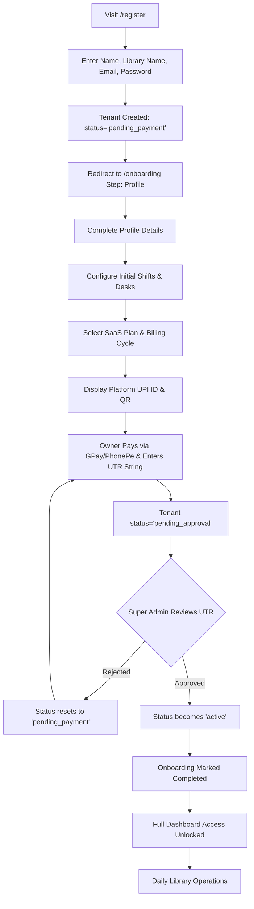

# StudyOS (Atlas Library) – Comprehensive Product, Feature & SaaS Business Readiness Audit

**Document Version:** 1.0.0  
**Audit Date:** November 2026  
**Auditor Roles:** Senior SaaS Product Analyst, Business Analyst, Technical Architect & Product Strategy Consultant  
**Project Workspace:** `e:\Library_project`  
**Current Branch / Codebase State:** `main` (Monorepo with uncommitted local work tree enhancements)

---

## 1. Executive Summary

StudyOS (referred to internally and in the codebase as *Atlas Library Management System* or `@atlas`) is a multi-tenant web application designed for operators of dedicated study rooms, reading halls, and competitive exam preparation libraries. 

### Core Strengths
1. **Solid Operational Core:** The single-library day-to-day desk allocation and membership management workflow is exceptionally well-engineered. Desk reservation conflict prevention is enforced with transactional rigor (`409 Conflict` on overlapping active date intervals).
2. **Financial Precision:** Currency is modeled strictly in integer paise (`feePaise`, `paidPaise`, `amountPaise`), preventing floating-point rounding errors. Sequential, tamper-evident receipt numbers (`REC-YYYY-XXXX`) are generated atomically via a dedicated MongoDB counter.
3. **Clean Monorepo Architecture:** TypeScript monorepo using npm workspaces (`@atlas/backend`, `@atlas/frontend`, `@atlas/shared`) with shared contract types and Zod-based request validation.

### Major SaaS & Commercial Readiness Gaps
1. **Subscription Architecture is Purely Manual:** There is no payment gateway integration (Stripe, Razorpay, Cashfree, Lemonsqueezy). Tenants "subscribe" by selecting a plan and typing a UPI transaction reference (UTR) into an input box. Activation requires manual review and approval by a platform Super Admin.
2. **Feature Gating is Unenforced Display Logic:** The feature lists attached to SaaS plans in the database (`SaasPlan.features`) are decorative strings rendered on pricing cards. The backend API (`apps/backend`) does not inspect the tenant's plan features to restrict access. Any tenant on any plan has identical access to shifts, WhatsApp templates, reports, and desks.
3. **Desk Tier Enforcement is Partial:** When adding desks (`POST /api/v1/seats`), the backend validates against `tenant.maxSeats`. However, if a tenant downgrades or seats were pre-seeded, student allocations do not check active plan limits.
4. **Subscription Expiry Lacks Automated Lifecycle Automation:** There is no background worker or cron job to transition past-due tenants or expire subscriptions. Verification occurs lazily on HTTP requests through `requireActiveTenant` middleware.
5. **Zero SaaS Billing Ledger:** SaaS subscription payments are not stored in any transaction ledger. The tenant document merely overwrites `lastUtrRef` and `lastPaymentSubmittedAt`. Historical SaaS invoice records, renewal histories, and audit logs do not exist.
6. **Zero External Communication Gateways:** WhatsApp messages are generated client-side via `https://wa.me/` URL schemes. There is no WhatsApp Business API, SMS gateway, or transactional email service (SendGrid, Resend, AWS SES) configured.

**Overall Verdict:** StudyOS is **Operationally Functional as a Single-Tenant or White-Glove Managed Library Tool**, but **Incomplete as an Automated Self-Serve Commercial B2B SaaS Platform**.

---

## 2. Current Product Status

| Dimension | Realized State in Codebase | Readiness Level |
|---|---|---|
| **Platform Administration** | Functional SuperAdmin dashboard for tenant status toggling, plan CRUD, and manual UTR approval. | **Beta / Operations-Ready** |
| **Library Operations** | Complete desk matrix, student profiles, shift assignments, and receipt generation. | **Production-Ready Core** |
| **SaaS Billing & Subscriptions** | Manual UTR submission and manual SuperAdmin activation. No payment gateway. | **Prototype / Manual Alpha** |
| **Multi-Tenancy Isolation** | Strong logical isolation via indexed `tenantId` in queries and middleware enforcement. | **Production-Ready Logical** |
| **External Communications** | Unintegrated. Client-side WhatsApp web links only. | **MVP Workaround** |
| **Automated Background Jobs** | Lazy on-request sync only (`membershipSync.service.ts`). No Redis, BullMQ, or node-cron. | **Technical Debt** |

---

## 3. Technical Architecture & Stack

### 3.1 Monorepo Layout
```
e:\Library_project
├── apps/
│   ├── backend/             # Node.js + Express 5, Mongoose ODM, JWT Auth
│   └── frontend/            # React 18, Vite, TailwindCSS, React Query, Lucide icons
├── packages/
│   └── shared/              # Shared TypeScript types, API contracts, Zod schemas
└── Docs/                    # Requirements, audit reports, and deployment manifests
```

### 3.2 Backend Architecture (`apps/backend`)
- **Runtime:** Node.js (v18+) with Express 5 (`5.0.1`).
- **Database:** MongoDB via Mongoose (`8.9.5`). Single shared database with row-level logical multi-tenancy (`tenantId` on every resource).
- **Authentication:** HTTP-only signed cookies storing JWTs (`accessToken`). Dual auth paths: Library Staff (`User` model) vs Platform SuperAdmin (`PlatformConfig` / environment credentials).
- **Security Middleware Chain:**
  1. `authenticate.ts`: Extracts and verifies JWT cookie. Attaches `req.user` (`userId`, `tenantId`, `role`).
  2. `requireActiveTenant.ts`: Verifies tenant status is `active` and checks `subscriptionExpiresAt > new Date()`.
  3. `tenantGuard.ts`: Enforces that the route's tenant scope matches `req.user.tenantId`.

### 3.3 Frontend Architecture (`apps/frontend`)
- **Framework:** React 18 with Vite.
- **State Management & Data Fetching:** TanStack React Query (`@tanstack/react-query`) for server cache sync; native React Context (`AuthContext.tsx`) for session state.
- **Routing:** React Router DOM v6 with protected route layouts (`ProtectedRoute.tsx`, `SuperAdminRoute.tsx`).
- **UI & Styling:** Tailwind CSS, Radix UI primitives, Lucide React icons, and custom modal sheets.

---

## 4. Complete Module Inventory

### 4.1 Module: Platform Authentication & Onboarding
- **Purpose:** Tenant registration, credential validation, JWT session issuing, password recovery, and initial setup wizard.
- **Screens & Routes:**
  - `/login` (`LoginPage.tsx`): Email/password authentication.
  - `/register` (`RegisterPage.tsx`): Dual-action registration (creates `Tenant` and owner `User`).
  - `/onboarding` (`OnboardingPage.tsx`): Multi-step setup wizard (`profile` -> `config` -> `subscription` -> `completed`).
- **Backend APIs:**
  - `POST /api/v1/auth/register`: Creates unactivated tenant, default shifts (Morning, Evening, Full Day), and owner user.
  - `POST /api/v1/auth/login`: Validates credentials, checks tenant active status, sets HTTP-only cookie.
  - `POST /api/v1/auth/logout`: Clears cookie.
  - `GET /api/v1/auth/me`: Returns current user session and tenant subscription status.
  - `POST /api/v1/auth/forgot-password` & `POST /api/v1/auth/reset-password`: OTP-based password recovery.
- **Access Roles:** Unauthenticated (public); transitions to `admin` / `staff`.
- **Implementation Status:** **Partially Implemented**. Registration and login are functional. However, email verification is non-existent (OTPs are merely logged or exposed via SuperAdmin). Self-serve onboarding stops at subscription selection because manual admin approval of payment is required.

---

### 4.2 Module: Super Admin Platform Management
- **Purpose:** Master control plane for the StudyOS platform owner.
- **Screens & Routes:**
  - `/superadmin` (`SuperAdminPage.tsx`): Platform-wide KPI overview, tenant approval queue, SaaS plan manager, platform UPI config, and user management.
- **Backend APIs:**
  - `GET /api/v1/superadmin/tenants`: Lists all libraries, subscription tiers, expiry dates, and pending approval statuses.
  - `PATCH /api/v1/superadmin/tenants/:id/status`: Suspends, activates, or cancels a tenant.
  - `POST /api/v1/superadmin/tenants/:id/approve-payment`: Approves manual UPI payment, extends subscription by 30 or 365 days, sets status to `active`.
  - `POST /api/v1/superadmin/tenants/:id/reject-payment`: Rejects UTR submission and resets status to `pending_payment`.
  - `POST /api/v1/superadmin/tenants/:id/reset-password`: Generates OTP or direct reset for library owners.
  - `GET /api/v1/superadmin/stats`: Aggregates total tenants, active libraries, pending revenue approvals, and gross MRR.
  - `GET / POST / PATCH / DELETE /api/v1/saas-plans`: Full CRUD for platform subscription tiers.
  - `GET / PATCH /api/v1/superadmin/config`: Configures platform receiving UPI ID and QR instructions.
- **Access Roles:** `superadmin` only (enforced by `requireSuperAdmin` middleware).
- **Implementation Status:** **Fully Functional (within manual operational scope)**. All buttons hook to working backend controllers. The limitation is operational design: approvals are 100% manual.

---

### 4.3 Module: SaaS Subscription & Plan Selection
- **Purpose:** Allows library owners to view available SaaS tiers, select a billing cycle, inspect payment details (UPI QR), submit payment proof, and track approval status.
- **Screens & Routes:**
  - `/subscription` (`SubscriptionPage.tsx`): Public/Tenant plan comparison matrix, UPI payment modal, and status banner.
- **Backend APIs:**
  - `GET /api/v1/saas-plans/active`: Public endpoint returning active published plans.
  - `POST /api/v1/library/subscription/select-plan`: Selects plan, billing cycle (`monthly` or `annual`), and generates expected amount.
  - `POST /api/v1/library/subscription/submit-payment`: Submits user-entered `utr` reference string. Sets tenant to `pending_approval`.
- **Database Models:** `SaasPlan`, `Tenant`, `PlatformConfig`.
- **Access Roles:** Authenticated library owners (`admin`).
- **Implementation Status:** **Partially Implemented**. The UI is sleek and functional, but payment capture is purely unverified text input (`utr` string). No automated bank/UPI webhook or payment gateway exists.

---

### 4.4 Module: Desk & Seat Management
- **Purpose:** Physical layout modeling, visual seat grid, desk categorization, occupancy tracking, and real-time vacancy inspection.
- **Screens & Routes:**
  - `/seats` (`SeatsPage.tsx`): Interactive desk grid, shift filter selector, vacancy summary cards, and desk creation dialog.
- **Backend APIs:**
  - `GET /api/v1/seats`: Returns all desks for tenant, decorated with current occupant details for selected shift.
  - `POST /api/v1/seats`: Creates single desk (validates `tenant.maxSeats`).
  - `POST /api/v1/seats/bulk`: Bulk generates desks (e.g., A-1 to A-50).
  - `PATCH /api/v1/seats/:id`: Updates desk label, type (`standard`, `premium`), or active state.
  - `DELETE /api/v1/seats/:id`: Deletes desk (prevented if active membership exists).
- **Database Models:** `Seat`, `Membership`, `Shift`.
- **Validation & Rules:**
  - Desks sorted via natural alphanumeric collation (`A-1, A-2 ... A-10`).
  - Prevents deleting or deactivating a desk if an active student is currently assigned to it.
  - Validates total seat count against `tenant.maxSeats`.
- **Implementation Status:** **Production-Ready**. Robust implementation with edge-case handling.

---

### 4.5 Module: Shifts & Library Operating Plans
- **Purpose:** Defines study time intervals (e.g., 06:00-14:00) and pricing packages offered by the library to students.
- **Screens & Routes:**
  - `/plans` (`PlansPage.tsx`): Shift manager (timings, active toggle) and Student Pricing Plans (monthly fee, shift association).
- **Backend APIs:**
  - `GET /api/v1/shifts` & `POST /api/v1/shifts`: Shift CRUD.
  - `GET /api/v1/plans` & `POST /api/v1/plans`: Library pricing plan CRUD.
- **Database Models:** `Shift`, `Plan`.
- **Access Roles:** `admin`, `staff`.
- **Implementation Status:** **Production-Ready**.

---

### 4.6 Module: Student Admissions & Directory
- **Purpose:** Student registration, contact profiling, government ID tracking, document notes, status tracking (`active`, `expired`, `left`), and communication links.
- **Screens & Routes:**
  - `/students` (`StudentsPage.tsx`): Searchable, filterable student table with status tabs (All, Active, Expiring, Expired, Left, No-Seat).
  - `/students/:id` (`StudentProfilePage.tsx`): Detailed student dossier showing personal details, membership history, payment timeline, and WhatsApp action buttons.
- **Backend APIs:**
  - `GET /api/v1/students`: Paginated search with status, shift, and seat filters.
  - `POST /api/v1/students`: Registers student.
  - `GET /api/v1/students/:id`: Detailed student record with populated membership and payment arrays.
  - `PATCH /api/v1/students/:id`: Updates contact info or marks student as `left`.
- **Database Models:** `Student`, `Membership`, `Payment`.
- **Implementation Status:** **Production-Ready**. Includes rich filter tabs, quick WhatsApp messaging triggers, and photo URL handling.

---

### 4.7 Module: Membership Lifecycle & Desk Allocation
- **Purpose:** Core engine binding a Student, a Seat, a Shift, and a Date Range into an active contract.
- **Screens & Routes:**
  - Embedded in `SeatsPage.tsx`, `StudentsPage.tsx`, and `StudentProfilePage.tsx` via assignment and renewal dialog modals.
- **Backend APIs:**
  - `POST /api/v1/memberships`: Allocates seat, assigns plan, records start/end dates, and calculates dues.
  - `POST /api/v1/memberships/:id/renew`: Extends membership for an additional duration, generates renewal payment record, and recalculates expiry.
  - `POST /api/v1/memberships/:id/cancel`: Terminates active allocation, freeing the desk immediately.
- **Conflict Prevention Engine:**
  - Executes MongoDB query checking: `seatId`, `shiftId`, `status: 'active'`, and date range overlap `(startDate <= newEndDate AND endDate >= newStartDate)`.
  - Throws HTTP `409 Conflict` with the conflicting student's name if occupied.
- **Implementation Status:** **Production-Ready Core**. Exceptional conflict-prevention reliability.

---

### 4.8 Module: Student Fee Collection & Invoicing
- **Purpose:** Records student fee payments, partial payments, payment modes (Cash, UPI, Card), overdue tracking, and printable receipts.
- **Screens & Routes:**
  - `/revenue` (`RevenuePage.tsx`): Revenue breakdown, transaction list, outstanding dues list, and receipt view modal.
- **Backend APIs:**
  - `GET /api/v1/payments`: Paginated list of student fee transactions with date and payment mode filters.
  - `POST /api/v1/payments`: Records collection against an active membership. Generates receipt number.
  - `GET /api/v1/payments/:id/receipt`: Returns structured receipt payload (`receiptNumber`, `studentName`, `seatNumber`, `shiftName`, `amountPaise`, `taxPaise`).
- **Database Models:** `Payment`, `Counter`.
- **Implementation Status:** **Production-Ready**. Receipts are clean, printable, and mathematically exact.

---

### 4.9 Module: Dashboard & Operational Analytics
- **Purpose:** Real-time visibility into occupancy, shifts, revenue collection, expiring admissions, and overdue fees.
- **Screens & Routes:**
  - `/dashboard` (`DashboardPage.tsx`): Metric KPI cards, expiring soon alert list, quick-action shortcuts.
- **Backend APIs:**
  - `GET /api/v1/dashboard/stats`: Aggregates active students, total seats, occupied seats, vacancy rate, today's collections, and pending renewals.
- **Implementation Status:** **Production-Ready**. Automatically invokes `membershipSync.service.ts` to ensure membership statuses are up to date before returning stats.

---

### 4.10 Module: Library Settings & Profile
- **Purpose:** Customizes library metadata, branding, address, and receipt notes.
- **Screens & Routes:**
  - `/profile` (`ProfilePage.tsx`): Library contact info, operational timings, and receipt footer text.
- **Backend APIs:**
  - `GET /api/v1/library/profile` & `PATCH /api/v1/library/profile`.
- **Implementation Status:** **Production-Ready**.

---

## 5. Library Owner Experience (End-to-End Journey)



### Detailed Friction & Breakdown Points:
1. **No Email / Phone Verification:** A user can register with any unverified email address (`fake@test.com`). There is no confirmation link or signup OTP.
2. **The "Pending Approval" Brick Wall:** Once the owner submits the UTR, they are locked out of operational features. If the Super Admin is asleep, away, or unresponsive, the library owner cannot configure their library or input students.
3. **No Payment Gateway:** If the owner mistypes their UTR, the platform has no automated way to reconcile it against bank statements.
4. **Independent Onboarding Impossible:** A library owner cannot self-onboard and go live in 5 minutes without manual human intervention from the platform owner.

---

## 6. Super Admin / Platform Management Audit

| Capability | Supported in Backend | Supported in Frontend | Operational Reality |
|---|---|---|---|
| **View All Tenants** | Yes (`GET /api/v1/superadmin/tenants`) | Yes (`SuperAdminPage.tsx`) | Fully functional. Lists libraries, owner contacts, status, and seats. |
| **Activate / Suspend Tenants** | Yes (`PATCH /status`) | Yes (Toggle Button) | Immediate effect via `requireActiveTenant` middleware. |
| **Approve / Reject UTR Payments** | Yes (`POST /approve-payment`, `/reject-payment`) | Yes (Action Buttons) | Updates status, adds 30/365 days to `subscriptionExpiresAt`. |
| **SaaS Plan Creation & Editing** | Yes (`/api/v1/saas-plans`) | Yes (Plan Modal Dialog) | Creates plans, sets prices, seat limits, and descriptive features. |
| **Configure Platform UPI** | Yes (`/api/v1/superadmin/config`) | Yes (UPI Config Form) | Saves `upiId` and `qrCodeUrl` to `PlatformConfig` collection. |
| **Owner Password Reset** | Yes (`/superadmin/tenants/:id/reset-password`) | Yes (Modal Action) | Generates temporary OTP or new password for owner. |
| **Live Bank Account Sync** | No | No | Non-existent. Super Admin must manually check their PhonePe/GPay app. |
| **Automated SaaS Invoicing** | No | No | No GST/tax invoices or downloadable receipts for SaaS subscriptions. |

---

## 7. Deep-Dive: Existing SaaS Subscription Architecture

### Q1: Is there a functional SaaS plan model and subscription model?
- **Answer:** `SaasPlan` exists as a complete Mongoose model (`apps/backend/src/models/SaasPlan.ts`) with fields: `name`, `code`, `priceMonthlyPaise`, `priceAnnualPaise`, `maxSeats`, `features` (array of strings), `isPopular`, `isActive`, and `sortOrder`.
- However, there is **no separate `Subscription` collection**. Subscription state is embedded directly into the `Tenant` document (`subscriptionTier`, `subscriptionStatus`, `subscriptionExpiresAt`, `billingCycle`, `lastUtrRef`, `lastPaymentSubmittedAt`).

### Q2: How are plans assigned to libraries?
- **Answer:** During onboarding or via `/subscription`, the library owner calls `POST /api/v1/library/subscription/select-plan` with `planCode` and `billingCycle`. The backend copies the plan code and sets the tenant's `subscriptionStatus = 'pending_payment'`.

### Q3: What happens when a library selects a plan?
- The backend updates `tenant.subscriptionTier = plan.code` and calculates `amountDuePaise` based on `billingCycle`. It does not grant feature access immediately.

### Q4: How is payment processed (payment gateway, manual proof, UPI, etc.)?
- **Answer:** 100% manual UPI proof submission. The frontend displays the platform's UPI ID (fetched from `PlatformConfig`). The user transfers money outside the platform, then types the 12-digit UPI UTR into a form and submits it via `POST /api/v1/library/subscription/submit-payment`.

### Q5: How is payment verified and approved?
- **Answer:** Manual review. The Super Admin logs into `/superadmin`, opens the "Payment Approvals" tab, matches the UTR against their bank account or UPI app manually, and clicks "Approve".

### Q6: How is subscription status tracked over time?
- **Answer:** Tracked via enum on `Tenant.subscriptionStatus`:
  - `pending_payment`: Plan chosen, no UTR submitted.
  - `pending_approval`: UTR submitted, waiting for Super Admin.
  - `active`: Super Admin approved; `subscriptionExpiresAt` set.
  - `past_due`: Expiry date has passed.
  - `cancelled`: Manually terminated by Super Admin.

### Q7: What happens when a subscription expires?
- **Answer:** When `subscriptionExpiresAt < new Date()`, the `requireActiveTenant` middleware blocks all library API endpoints (returning HTTP `403 Forbidden` with `{ code: 'SUBSCRIPTION_EXPIRED' }`). The frontend intercepts this and redirects to `/subscription`.
- **Critical Flaw:** There is no scheduled cron job to actively update the status string to `'past_due'` in the database. The status remains `'active'` in the database until evaluated on request.

### Q8: Is seat capacity enforced based on the subscribed plan?
- **Answer:** **Partially.** When creating desks (`POST /api/v1/seats` and `POST /api/v1/seats/bulk`), `seat.controller.ts` validates:
  ```typescript
  const currentCount = await Seat.countDocuments({ tenantId, isDeleted: false });
  if (currentCount + countToAdd > tenant.maxSeats) {
    return res.status(403).json({ error: `Seat limit reached for your plan (${tenant.maxSeats} max).` });
  }
  ```
- **The Gap:** `tenant.maxSeats` is set when the Super Admin approves the plan. If a tenant downgrades plans, existing seats are not soft-deleted or locked, and student allocations to pre-existing desks remain fully functional.

### Q9: Are features gated based on plan permissions?
- **Answer:** **NO.** Feature gating is **completely unenforced** in the backend. 
  - `SaasPlan.features` is an arbitrary array of strings (e.g., `["Multi-shift", "WhatsApp Reminders", "Advanced Reports"]`).
  - There is no permissions middleware (e.g., `requireFeature('whatsapp')`).
  - Any tenant with an active subscription has identical access to all endpoints.

### Q10: Is there a payment history or billing ledger for SaaS subscriptions?
- **Answer:** **NO.** The platform has a `Payment` collection, but it is strictly used for **Student Fee Collections**. SaaS subscription transactions are never written to a ledger. The tenant document holds only the single latest payment (`lastUtrRef`, `lastPaymentSubmittedAt`). Previous subscription payments and invoices are overwritten and lost.

---

## 8. Feature Entitlement Matrix: Plan Claims vs Actual Code Enforcement

| Advertised Feature | Basic / Starter | Standard / Growth | Premium / Pro | Enforced in Code? | Reality in Codebase |
|---|---|---|---|---|---|
| **Desk Capacity** | e.g. 50 Desks | e.g. 100 Desks | Unlimited / 250 | **Yes (on creation only)** | Enforced when inserting new seats. Not enforced on student allocations or plan downgrades. |
| **Shift Management** | Advertised as 1 Shift | Advertised as 2 Shifts | All Shifts (Multi-shift) | **NO** | Any tenant can create infinite shifts (`POST /api/v1/shifts`). No plan check exists in `shift.controller.ts`. |
| **WhatsApp Notifications** | "Basic" or "Not Included" | "Included" | "Custom Templates" | **NO** | WhatsApp buttons are client-side links (`wa.me`). Available to all tenants regardless of plan. |
| **Revenue & Financial Reports** | "Basic" | "Full Analytics" | "Export & Advanced" | **NO** | `RevenuePage.tsx` and `/api/v1/payments` are unrestricted for any active tenant. |
| **Student Directory & Profiles** | Included | Included | Included | **Yes** | Standard operational feature. |
| **Digital Receipts** | Included | Included | Included | **Yes** | Standard operational feature. |
| **Staff Accounts** | 1 User | 3 Users | Unlimited | **NO** | Any admin can invite/create staff users. User count is not checked against `SaasPlan`. |

---

## 9. Library Management Workflow Audit (14 Real-World Workflows)

```
[1. Student Walk-in & Registration]          --> FULLY FUNCTIONAL
[2. Seat Allocation with Shift Selection]    --> FULLY FUNCTIONAL (with conflict protection)
[3. Fee Collection (Full Payment)]           --> FULLY FUNCTIONAL (generates receipt)
[4. Fee Collection (Partial / Installment)]  --> FULLY FUNCTIONAL (tracks remaining dues)
[5. Receipt Generation & Printing]           --> FULLY FUNCTIONAL (clean print view)
[6. Desk Conflict Resolution]                --> FULLY FUNCTIONAL (atomic 409 rejection)
[7. Student Membership Renewal]              --> FULLY FUNCTIONAL (extends dates, adds payment)
[8. Seat Swap / Shift Change]                --> PARTIAL (Requires manual cancel & re-allocate)
[9. Student Exit / De-allocation]            --> FULLY FUNCTIONAL (frees seat, marks student left)
[10. Daily Attendance / Check-in]            --> NOT IMPLEMENTED (No attendance model or QR scan)
[11. WhatsApp Fee Dues Reminders]            --> PARTIAL (Opens wa.me client link; no automated bot)
[12. Overdue Dues Tracking]                  --> FULLY FUNCTIONAL (filtered tab in /revenue)
[13. Expense Management]                     --> NOT IMPLEMENTED (No expense tracker in codebase)
[14. Day-end Financial Settlement]           --> PARTIAL (Viewable on dashboard; no day-close lock)
```

---

## 10. External Integrations and Operating Costs

### 10.1 Integrations Audit
1. **Payment Gateways (Razorpay / Stripe / Cashfree):** **None.** Everything is manual UPI UTR text entry.
2. **Transactional Email (SendGrid / Resend / AWS SES):** **None.** System cannot send verification emails or automated receipts.
3. **SMS Gateway (Twilio / MSG91):** **None.**
4. **WhatsApp Business API (Gupshup / Wati / Meta Cloud API):** **None.** Uses client-side `window.open('https://wa.me/91...?text=...')` deep links.
5. **Cloud File Storage (AWS S3 / Cloudinary):** **None.** Profile photos and documents rely on external string URLs; no direct binary upload pipeline exists.

### 10.2 Current Infrastructure & Monthly Operating Cost Breakdown
Because the project relies on free-tier services and manual workarounds, current direct hosting costs are nearly zero:

| Service | Tier / Plan | Current Monthly Cost | Scaled Cost (at 100 Libraries) |
|---|---|---|---|
| **Backend API (Render)** | Free Web Service (Spins down on idle) | $0.00 | $25.00 - $50.00 (Standard Instance) |
| **Frontend UI (Netlify)** | Starter Free Tier | $0.00 | $0.00 - $19.00 (Pro) |
| **Database (MongoDB Atlas)** | M0 Free Shared Sandbox (512MB limit) | $0.00 | $57.00 - $80.00 (M10 Dedicated) |
| **WhatsApp Business API** | Unintegrated (wa.me) | $0.00 | ~$30.00 - $60.00 (Meta conversation charges) |
| **Transactional Email (Resend)**| Unintegrated | $0.00 | $20.00 (40,000 emails/mo) |
| **Payment Gateway (Razorpay)** | Unintegrated | $0.00 | 2% per transaction volume |
| **Domain & SSL** | Default subdomains (`.netlify.app`, `.onrender.com`) | $0.00 | $15.00 / year |
| **Estimated Total:** | | **$0.00 / month** | **~$150.00 - $220.00 / month** |

---

## 11. Security and Multi-Tenant Assessment

### 11.1 Multi-Tenant Data Isolation
- **Mechanism:** Logical row-level tenancy using indexed `tenantId: { type: Schema.Types.ObjectId, ref: 'Tenant', index: true }` across all 11 Mongoose collections.
- **Enforcement:**
  - `authenticate` middleware extracts `tenantId` from JWT.
  - Queries in controllers strictly filter by `{ tenantId: req.user.tenantId }`.
  - Seat and Membership mutations verify that cross-referenced entities (e.g. `studentId`, `seatId`, `planId`) belong to the requesting tenant.
- **Isolation Rating:** **Strong Logical Isolation**. Cross-tenant leakage is prevented in controllers.

### 11.2 Authentication & Token Security
- **Mechanism:** JWT stored in HTTP-only, secure, signed cookies (`SameSite: 'none'`, `Secure: true`).
- **Strengths:** Protected against Cross-Site Scripting (XSS) token theft.
- **Vulnerabilities:**
  - No Refresh Token rotation. Access token has a standard expiration without a silent refresh mechanism.
  - No rate-limiting on sensitive endpoints (`/api/v1/auth/login`, `/api/v1/auth/forgot-password`). Vulnerable to credential stuffing and brute-force attacks.

### 11.3 Password & Secret Handling
- Passwords hashed using bcrypt (10 rounds).
- SuperAdmin credentials can fall back to hardcoded defaults in code if environment variables are omitted (`superadmin.controller.ts`). **High security risk for production deployment.**

---

## 12. Product Gaps and Risks (Prioritized Matrix)

### Priority P0 (Immediate Launch Blockers for Commercial SaaS)
1. **No Automated Payment Gateway:** Manual UTR entry requires constant SuperAdmin vigilance, delays onboarding by hours/days, and allows fraudulent UTR input.
2. **Missing SaaS Billing Ledger:** No financial audit trail for platform subscription revenues, no downloadable SaaS receipts/invoices for library owners.
3. **Absence of Real-Time Automated Cron Expiry:** Subscriptions do not transition to `past_due` automatically; expired tenants are only evaluated on incoming web traffic.
4. **Hardcoded Fallback Credentials:** Backend contains hardcoded fallback credentials for SuperAdmin in source code.
5. **No Production Domain or Reverse Proxy:** Currently operating across separate third-party domains (`netlify.app` and `onrender.com`), introducing browser cookie blocking risks on Safari and strict privacy browsers.

### Priority P1 (Essential for Customer Retention & Usability)
1. **Unenforced Feature Gating:** Features advertised in higher plans (e.g., multi-shift, analytics) are accessible on the lowest plan.
2. **Automated WhatsApp Reminders:** Library owners must manually click individual WhatsApp links per student. No automated morning reminders or bulk expiry alerts.
3. **No Automated Image/ID Upload Pipeline:** Profile photos require typing an external URL rather than uploading a file from mobile camera or storage.
4. **No Seat Swapping Workflow:** Changing a student's seat requires canceling their membership and creating a new one, breaking transaction continuity.

### Priority P2 (Scalability & Value-Add Enhancements)
1. **Student QR / Mobile Attendance:** No mechanism to track whether a student actually sat at their desk.
2. **Expense & Utility Tracker:** Library owners cannot track electricity bills, rent, or Wi-Fi expenses against fee revenues.
3. **SMS / Email Fallback:** Dependent entirely on student mobile numbers with active WhatsApp accounts.

---

## 13. SaaS Commercial Readiness Assessment

### 1. Can StudyOS be sold to library owners today?
**Technically Yes, but Operationally as a "White-Glove Managed Service", NOT a Self-Serve SaaS.**  
You can onboard customers if you personally supervise their registration, manually verify their UPI transfers, and activate their accounts in the SuperAdmin panel.

### 2. What happens when a library owner registers today?
They create an account, complete profile steps, pick a plan, and are stopped at a screen asking them to transfer money via UPI and paste a UTR number. They cannot access their dashboard until you manually approve them.

### 3. What stops StudyOS from scaling to 500 libraries?
The 100% manual payment approval bottleneck, lack of automated subscription accounting, lack of automated transactional communications, and reliance on free-tier infrastructure that will throttle under load.

### 4. How complete is platform administration?
The UI and controllers are **85% complete** for manual oversight. It allows tenant activation, suspension, plan authoring, and UTR validation. It lacks financial export ledgers and automated dispute handling.

### 5. How complete is the library management experience?
**90% complete for core desk operations.** Desk allocation, shift conflict blocking, fee receipts, and student directories are robust, reliable, and production-grade.

### 6. Where are the largest discrepancies between documentation and code?
- *Doc Claim:* Multi-tier SaaS with feature-based gating.  
  *Code Reality:* Feature gating is decorative; all active tenants access all features.
- *Doc Claim:* Automated subscription management.  
  *Code Reality:* Manual UTR text field with manual SuperAdmin approval.
- *Doc Claim:* Automated WhatsApp notifications.  
  *Code Reality:* Unofficial browser-redirect deep links (`wa.me`).

### 7. What is the single highest-risk architectural issue?
The lack of an isolated, automated subscription transaction ledger and the lack of a payment gateway webhook. A SaaS platform cannot maintain financial integrity by overwriting a `lastUtrRef` string on a tenant record.

### 8. What is the fastest path to commercial readiness?
Integrate **Razorpay Subscriptions / Payment Gateway** for SaaS plans, add a 24-hour node-cron for subscription status updates, enforce `tenant.maxSeats` across all student allocations, and host both apps under a single custom domain (e.g., `app.studyos.in` and `api.studyos.in`).

---

## 14. Recommended Action Priorities

```mermaid
flowchart LR
    subgraph Sprint 1: Commercial Foundations
        A1[Integrate Razorpay / Stripe Gateway] --> A2[Create SaasPayment Ledger Model]
        A2 --> A3[Implement Node-Cron Expiry Worker]
    end
    subgraph Sprint 2: Feature Integrity
        B1[Enforce Plan Feature Middleware] --> B2[Enforce Desk Capacity on Allocation]
        B2 --> B3[Native Image/ID File Upload Pipeline]
    end
    subgraph Sprint 3: Growth & Value
        C1[Official WhatsApp Business API] --> C2[Seat Swapping Feature]
        C2 --> C3[Custom Domain & Production SSL Setup]
    end
    Sprint 1 --> Sprint 2 --> Sprint 3
```

---

## 15. Questions Requiring Product Owner Decisions

1. **Payment Gateway Selection:** Which payment gateway will be used for automated SaaS subscription collection (Razorpay, Cashfree, or Stripe India)?
2. **Manual UPI Support:** Do you wish to retain manual UPI UTR submission as a fallback for tier-2/3 Indian library owners who do not use corporate credit/debit cards or auto-debit mandates?
3. **Feature Gating Strategy:** Which exact features should be strictly locked behind higher plans? (e.g., Is Multi-shift strictly a "Growth" tier feature? Will basic libraries be capped at 1 shift?)
4. **WhatsApp Communication Model:** Will StudyOS provide a centralized WhatsApp Business API number (charging library owners per message), or should library owners continue using free client-side `wa.me` links from their own phones?
5. **Branding & Naming Finalization:** The codebase currently uses `Atlas Library Management System` and `@atlas/*` packages, while product documentation refers to `StudyOS`. Should a unified rebranding refactor be scheduled before commercial customer launch?

---

## Summary Matrix: Status, Evidence, and Gaps

| Area | Status | Evidence in Codebase | Main Gap | Priority |
|---|---|---|---|---|
| **Multi-Tenant Isolation** | **Production-Ready** | `tenantId` indexed in all 11 models; enforced in middleware and queries | None; data isolation is robust | Low |
| **Desk & Shift Matrix** | **Production-Ready** | `Seat.ts`, `Shift.ts`, `seat.controller.ts` | Natural collation working; cannot swap seats in one click | Low |
| **Desk Conflict Engine** | **Production-Ready** | `membership.controller.ts` overlapping interval queries return 409 | None; double-booking is physically blocked | Low |
| **Financial Accounting (Students)**| **Production-Ready** | Integer paise in `feePaise`, atomic `Counter.ts` for receipts | No expense ledger; no day-end financial register close | Medium |
| **Student Directory & Profiles** | **Production-Ready** | `Student.ts`, `StudentProfilePage.tsx`, status filter tabs | Image/photo upload relies on URL string, no S3 | Medium |
| **Platform Control (SuperAdmin)** | **Beta / Functional** | `superadmin.controller.ts`, `PlatformConfig.ts`, `SuperAdminPage.tsx` | No financial audit export; manual approval burden | High |
| **SaaS Plan Management** | **Beta / Functional** | `SaasPlan.ts`, `saasPlan.controller.ts` | Feature array is decorative; no backend enforcement | High |
| **SaaS Subscription Billing** | **Manual Prototype** | `Tenant.lastUtrRef`, `select-plan` and `submit-payment` routes | No payment gateway; no SaaS transaction ledger | **P0** |
| **Lifecycle Expiry Automation** | **Incomplete** | Lazy checks in `requireActiveTenant.ts`; no cron or background worker | Expired status not updated in DB without traffic | **P0** |
| **External Communications** | **MVP Workaround** | `window.open('https://wa.me/...')` in `StudentProfilePage.tsx` | No transactional email, SMS, or WhatsApp API | **P1** |
| **Security & Production Config** | **Needs Hardening** | Hardcoded superadmin fallbacks; Render/Netlify cross-origin cookies | Lack of custom domain; lack of auth rate-limiting | **P0** |
